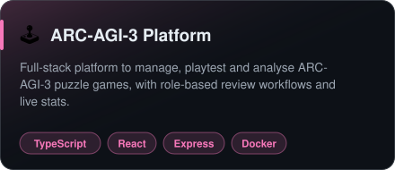
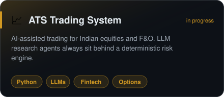
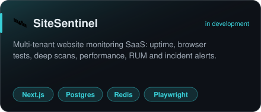
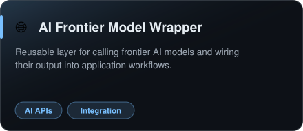

<div align="center">


<p>
<a href="https://sarbeshtiwari.vercel.app"></a>
<a href="https://www.linkedin.com/in/sarbeshtiwari"></a>
<a href="https://x.com/TiwariSarbesh"></a>
<a href="mailto:tiwarisarbesh02@gmail.com"></a>

</p>

</div>

<table>
<tr>
<td width="58%" valign="top">

### 🧠 About me

I build AI systems that can be **measured**, and the software that ships them.

- 🔬 **Now:** LLM evaluation, reasoning benchmarks and frontier-model datasets at **Quess Corp**
- 🤖 **Building:** AI agents, evaluation harnesses and AI-powered products
- 🌐 **Shipping:** full-stack apps with Python, FastAPI, React, Next.js and Node.js
- 📍 Gurugram, India · open to interesting AI work

</td>
<td width="42%" valign="top">

```python
class Sarbesh:
    role  = ["AI/ML Engineer",
             "LLM Evaluation",
             "Full-Stack"]
    focus = ["Reasoning benchmarks",
             "AI agents",
             "Production software"]
    motto = "Build → Measure → Ship"
```

</td>
</tr>
</table>

## 🛠️ Tech stack

<p align="center">

<br/>

<br/>

</p>

<p align="center">


</p>

## 🚀 Featured projects

<table>
<tr>
<td width="50%"><a href="https://github.com/sarbeshtiwari/pencil-puzzle-bench"></a></td>
<td width="50%"><a href="https://github.com/sarbeshtiwari/arc-agi-3"></a></td>
</tr>
<tr>
<td width="50%"><a href="https://github.com/sarbeshtiwari/reachout-backend"></a></td>
<td width="50%"><a href="https://github.com/sarbeshtiwari/voicepilot"></a></td>
</tr>
<tr>
<td width="50%"><a href="https://github.com/sarbeshtiwari/trading-software"></a></td>
<td width="50%"><a href="https://github.com/sarbeshtiwari/adpilot"></a></td>
</tr>
<tr>
<td width="50%"></td>
<td width="50%"></td>
</tr>
</table>

## 🧭 Journey


**Certifications:** ☁️ AWS Certified Cloud Practitioner · 🤖 AI/ML in Python · 🧠 Machine Learning · 🗄️ IBM SQL & Relational Databases · 🔐 Cisco Intro to Cybersecurity · 📱 Android Bug Bounty · 🎵 ML in Sound

## 📊 GitHub activity

<div align="center">


<picture>
  <source media="(prefers-color-scheme: dark)" srcset="https://raw.githubusercontent.com/sarbeshtiwari/sarbeshtiwari/output/snake-dark.svg"/>
  
</picture>

</div>

<div align="center">

### Building something with AI? Let's talk.

<a href="https://sarbeshtiwari.vercel.app"></a>
<a href="https://www.linkedin.com/in/sarbeshtiwari"></a>
<a href="mailto:tiwarisarbesh02@gmail.com"></a>


</div>
