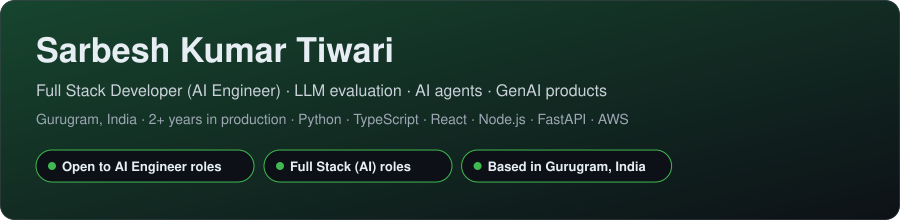
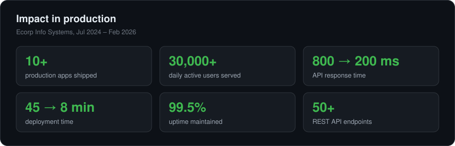
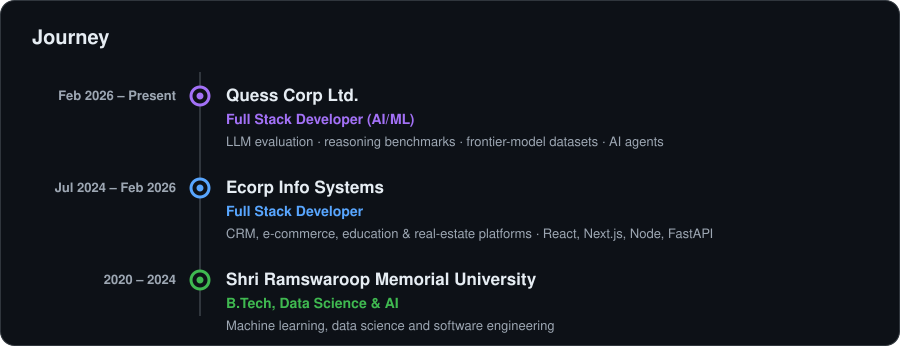
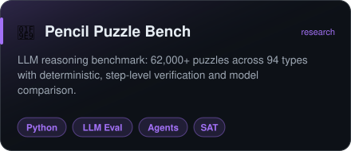
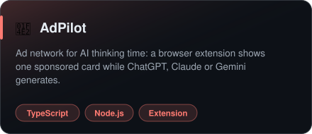
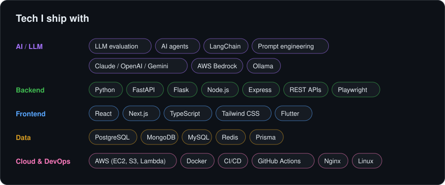

<p align="center">
  
</p>

<p align="center">
  <a href="https://sarbeshtiwari.vercel.app"></a>
  <a href="https://www.linkedin.com/in/sarbeshtiwari"></a>
  <a href="mailto:tiwarisarbesh02@gmail.com"></a>
</p>

## For recruiters and hiring partners

| | |
|---|---|
| **Role** | Full Stack Developer (AI Engineer) at Quess Corp Ltd., assigned to Ethara.ai |
| **Looking for** | AI Engineer · LLM / GenAI Engineer · Full Stack Developer (AI) |
| **Experience** | 2+ years building and running production software (since Jul 2024), plus earlier Flutter app work |
| **Core strengths** | LLM evaluation and benchmarking · AI agents · Python / FastAPI and Node.js backends · React / Next.js · AWS and Docker |
| **Location** | Gurugram, India |
| **Education** | B.Tech, Data Science and Artificial Intelligence, Shri Ramswaroop Memorial University (2020 – 2024) |
| **Fastest way to reach me** | [tiwarisarbesh02@gmail.com](mailto:tiwarisarbesh02@gmail.com) or [LinkedIn](https://www.linkedin.com/in/sarbeshtiwari) |

**What I bring to a team**

- **I ship complete products.** Backend, frontend, deployment and the AI inside them, from first commit to production users.
- **I make AI measurable.** At Ethara.ai I evaluate and benchmark frontier-model reasoning (ARC-AGI-3, Pencil Puzzle Bench), build datasets for frontier models and analyse agent trajectories.
- **I build AI people can trust.** My projects keep a human in control: AI proposals pass deterministic checks, nothing is sent or applied without consent, and facts are traced to their source.

<p align="center"></p>

## Experience

<p align="center"></p>

## Featured projects

<table>
<tr>
<td width="50%"><a href="https://github.com/sarbeshtiwari/reachout-backend"></a></td>
<td width="50%"><a href="https://github.com/sarbeshtiwari/pencil-puzzle-bench"></a></td>
</tr>
<tr>
<td><a href="https://github.com/sarbeshtiwari/voicepilot"></a></td>
<td><a href="https://github.com/sarbeshtiwari/adpilot"></a></td>
</tr>
<tr>
<td><a href="https://github.com/sarbeshtiwari/trading-software"></a></td>
<td><a href="https://github.com/sarbeshtiwari/sitesentinel"></a></td>
</tr>
</table>

| Project | What it shows | Stack |
|---|---|---|
| [**Reachout**](https://github.com/sarbeshtiwari/reachout-backend) · [live app](https://reachout-web.netlify.app) | An AI agent for the whole job search: 100+ job boards, resume-aware ranking, reorder-only tailored resumes (LaTeX), company research with source-checked facts, consent-based auto-apply, learning from feedback and a 90-day interview course | Python, Flask, MongoDB, LangChain, Claude Code, Playwright, React |
| [**Pencil Puzzle Bench**](https://github.com/sarbeshtiwari/pencil-puzzle-bench) | LLM reasoning evaluation on 62,000+ verifiable puzzles: production CLI, JSONL trajectory tracing, AWS Bedrock and GLM providers, multi-run statistics | Python, LLM APIs |
| [**VoicePilot**](https://github.com/sarbeshtiwari/voicepilot) | Voice control for terminal AI agents with fully local speech recognition and PTY integration | Python, faster-whisper |
| [**AdPilot**](https://github.com/sarbeshtiwari/adpilot) | Ad network for AI "thinking time": Chrome extension, auction-based ad selection, ledger billing, Razorpay wallets, three portals | TypeScript, Express, Prisma, PostgreSQL, Redis, React |
| [**ATS**](https://github.com/sarbeshtiwari/trading-software) | AI-assisted trading: LLM proposals are schema-validated and must pass a deterministic risk engine; paper trading | Python, FastAPI, TimescaleDB, Redis |
| [**SiteSentinel**](https://github.com/sarbeshtiwari/sitesentinel) | Multi-tenant website monitoring and incident management with PostgreSQL row-level security | TypeScript, Next.js, Node.js, PostgreSQL, Redis |

More client work (e-commerce, real-estate, CRM, school and news platforms serving up to 15,000 daily users) is on my [portfolio](https://sarbeshtiwari.vercel.app).

<p align="center"></p>

## GitHub activity

<p align="center">
  <picture>
    <source media="(prefers-color-scheme: dark)" srcset="https://raw.githubusercontent.com/sarbeshtiwari/sarbeshtiwari/output/snake-dark.svg">
    
  </picture>
</p>

## Certifications and courses

AWS Cloud Practitioner (course completed) · AI/ML in Python · Machine Learning with Python (IBM) · IBM SQL and Relational Databases · Big Data and Hadoop Foundations (IBM) · Cisco Introduction to Cybersecurity · Smart India Hackathon · ML in Sound · Android Bug Bounty

<p align="center"><b>Hiring for AI or full-stack roles?</b> <a href="mailto:tiwarisarbesh02@gmail.com?subject=Opportunity%20for%20Sarbesh">Email me</a> · <a href="https://www.linkedin.com/in/sarbeshtiwari">Connect on LinkedIn</a></p>

---

<details>
<summary><b>About this repository (source of the portfolio website)</b></summary>

This repository is also the source of [sarbeshtiwari.vercel.app](https://sarbeshtiwari.vercel.app): a Next.js 15 (App Router), React 19 and TypeScript site with self-hosted fonts, SEO (sitemap, structured data, Open Graph image) and a contact form.

```sh
npm install
npm run dev      # http://localhost:3000
npm run build && npm start
```

Content lives in `app/data/` (projects, experience, certifications, site metadata). The contact form needs `GMAIL_USER` and `GMAIL_PASS` (a Gmail app password) in `.env.local`; without them it offers a direct email link instead.

</details>
