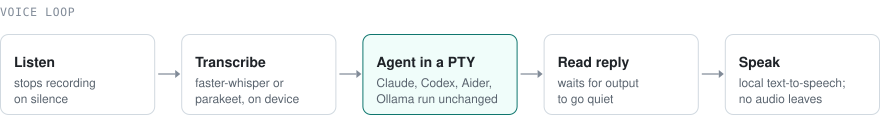
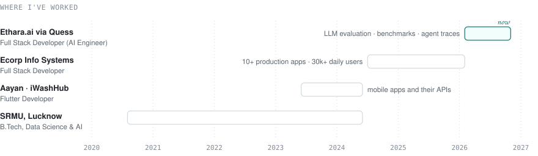

I evaluate how frontier models reason, and I build the software around AI that decides whether it's useful. At Ethara.ai (through Quess Corp) I run reasoning benchmarks such as ARC-AGI-3 and Pencil Puzzle Bench, build datasets for frontier models and read agent trajectories to find the step where a plan goes wrong. Before that I spent two years at Ecorp shipping production web applications, so most of what I build has a real backend, a UI and a deployment behind the model call.

The question I keep coming back to: how do you measure whether an AI system works, and how do you let it act without handing it the keys?

[portfolio ↗](https://sarbeshtiwari.vercel.app) · [linkedin ↗](https://www.linkedin.com/in/sarbeshtiwari) · [tiwarisarbesh02@gmail.com](mailto:tiwarisarbesh02@gmail.com)

### what i'm working on

- **LLM evaluation.** Benchmarks with machine-checkable answers, repeated runs instead of single scores, and trajectory traces that show *how* a model failed.
- **Agents with guardrails.** Models propose; deterministic code decides. A risk engine the AI can't bypass, resume edits that may only reorder, facts kept only when their source page shows them.
- **Local-first AI tooling.** On-device speech recognition, local models through Ollama, and Claude Code as a runtime for tools that run on my own machine.

 

## things i've built lately
*mostly agents, newest first*

### Reachout

An AI agent that runs a job search end to end, with a person approving every step.  
[Backend](https://github.com/sarbeshtiwari/reachout-backend) · [Frontend](https://github.com/sarbeshtiwari/reachout-frontend) · [Live app](https://reachout-web.netlify.app)

Job hunting is a loop of searching, tailoring, applying and following up across dozens of sites, and most tools either spam or break the sites' rules. Reachout reads 100+ job boards and companies' own career pages, ranks each opening against the resume with a LangChain pipeline (Claude Code or a local Ollama model) and explains every score. It learns from Good fit / Not for me and from what happens after an application, moving scores by at most 15 points and saying why. A tailored resume may only reorder what's already there; each change is rule-checked and the result is typeset with LaTeX. Company research keeps a fact only if the cited page actually shows it. Auto-apply works only on public forms, with consent, and sites that forbid automation are on a hard block list.

Python · Flask · MongoDB (field-level encryption) · LangChain · Playwright · React · 186 tests

### Pencil Puzzle Bench

My additions to an open benchmark for LLM reasoning on puzzles with exactly verifiable solutions.  
[My fork](https://github.com/sarbeshtiwari/pencil-puzzle-bench) · [Upstream](https://github.com/approximatelabs/pencil-puzzle-bench)

A single benchmark score hides most of what matters: how stable it is across runs and where a model goes off track. I added a production benchmark CLI (several models and strategies at once, concurrency, seeds, dry runs), JSONL trajectory tracing for every run, AWS Bedrock (Converse API) and Zhipu GLM providers, and multi-run evaluation so variance is measured rather than guessed.

Python · AWS Bedrock · LLM APIs

### ATS

A trading system for Indian equities and F&O where AI agents may propose trades but can never place one on their own. *Under construction.*  
[Repository](https://github.com/sarbeshtiwari/trading-software)

Every order passes a deterministic risk engine that no AI component can bypass, widen or disable. It has three separate modes: paper (the default), supervised (a person approves each order) and live (only after explicit arming). The audit trail answers "why did you take this trade?" and "why didn't you?". Foundations and indicators, Greeks and option-chain analytics are built and tested; the full trading pipeline isn't finished yet, and the repository says exactly what is.

Python · FastAPI · TimescaleDB · Redis · Claude API · Groww TradeAPI

### VoicePilot

Voice control for terminal AI agents, running entirely on the machine.  
[Repository](https://github.com/sarbeshtiwari/voicepilot)

It wraps Claude, Codex, Aider or Ollama in a pseudo-terminal, so the agent behaves exactly as normal and you can still type. It records until you stop talking, transcribes locally (faster-whisper, or parakeet / mlx-whisper on Apple Silicon), waits for the agent's output to go quiet and reads the reply back. No API keys, and no audio leaves the computer.

Python · faster-whisper · PTY / ConPTY · macOS, Linux, Windows

#### also on the bench

- [**SiteSentinel**](https://github.com/sarbeshtiwari/sitesentinel): multi-tenant website monitoring and incident management, with tenant isolation through PostgreSQL row-level security and SSRF-safe egress for checks. In development. TypeScript · Next.js · PostgreSQL · Redis · Playwright
- [**AdPilot**](https://github.com/sarbeshtiwari/adpilot): an ad network for the seconds while a model is generating. A Chrome MV3 extension, three portals, hashed session tokens and TOTP-protected admin. In development. TypeScript · Express · Prisma · PostgreSQL · Redis
- [**ARC-AGI-3 platform**](https://github.com/sarbeshtiwari/arc-agi-3): the internal platform for playtesting and reviewing ARC-AGI-3 puzzle games, with four roles, a multi-stage approval workflow, live notifications and per-level session stats. TypeScript · Express · React · Python

 

**Full Stack Developer (AI Engineer)** · Quess Corp Ltd., assigned to Ethara.ai · Feb 2026 – present  
LLM evaluation and reasoning benchmarks (ARC-AGI-3, Pencil Puzzle Bench), datasets for frontier models, agent-trajectory analysis, and the Python and Node.js services behind them.

**Full Stack Developer** · Ecorp Info Systems, Noida · Jul 2024 – Feb 2026  
Built and ran 10+ production applications (CRM, e-commerce, real estate, school and news platforms) serving 30,000+ daily active users combined. Brought API response time from 800 ms to 200 ms and deployments from 45 to 8 minutes, with 99.5% uptime, across 50+ REST endpoints.

**Flutter Developer** · Aayan India and iWashHub, Lucknow · 2023 – 2024  
Mobile apps from scratch: authentication, booking and order tracking, payments and the Node.js backends behind them.

**B.Tech, Data Science and Artificial Intelligence** · Shri Ramswaroop Memorial University · 2020 – 2024

 

<picture>
  <source media="(prefers-color-scheme: dark)" srcset="https://raw.githubusercontent.com/sarbeshtiwari/sarbeshtiwari/output/snake-dark.svg">
  
</picture>

**Certifications** · Smart India Hackathon finalist · IBM: Machine Learning with Python, Data Analysis with Python, SQL and Relational Databases, Big Data and Hadoop Foundations · Introduction to Machine Learning with Sound · AWS Cloud Practitioner (course) · Cisco Introduction to Cybersecurity

 

**say hi.** If you're hiring for AI or full-stack engineering, I'd like to hear about it: [tiwarisarbesh02@gmail.com](mailto:tiwarisarbesh02@gmail.com) or [LinkedIn](https://www.linkedin.com/in/sarbeshtiwari).

 
